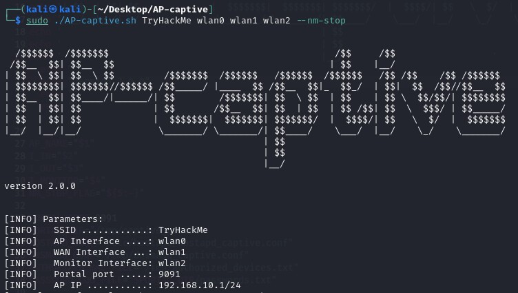

# AP-captive
[](https://opensource.org/licenses/MIT)  
AP-captive creates a passwordless access point that can be connected to. Connecting users are still prompted to enter a password, which is saved by the access point.

  

## Disclaimer
This tool is provided for authorized security testing, research, and educational purposes only.
If you use this tool for any activity involving attacks, exploitation, or security testing against individuals, companies, systems, or networks, you must have explicit prior authorization from the relevant person, organization, or asset owner.

Unauthorized use is strictly prohibited. The author assumes no responsibility for any misuse or damage caused by this tool.

## Description
**AP-captive** AP-captive is activated on a PC (e.g., a Kali Linux) that uses three antennas to operate:
- antenna0 (e.g., wlan0): Used to connect Kali Linux to the Internet;
- antenna1 (e.g., wlan1): Used to activate an Access Point with a specific ESSID;
- antenna2 (e.g., wlan2): Used to perform deauthentication attacks on antennas with the same ESSID.

  
## Example Usage
 ```
sudo ./AP-captive.sh TryHackMe wlan0 wlan1 wlan2 --nm-stop
 ``` 


Any passwords will be saved in the file **/tmp/captive_portal/passwords.txt**

  
## Command-line parameters
```
sudo ./AP-captive.sh TryHackMe wlan0 wlan1 wlan2 --nm-stop
```

| Parameter | Description                          | Example       |
|-----------|--------------------------------------|---------------|
| `ESSID`      | ESSID of the Access Point to be created | `TryHackMe`, `myAP`, ... |
| `wlan0`      | internet-connected interface         | `wlan0`,`eth0`           |
| `wlan1`      | interface that activates the access point         | `wlan1`          |
| `wlan2`      | interface that in monitor mode performs deauthentication attacks on Access Points that have the same ESSID activated by the script         | `wlan2`          |

  
## How to install it on Kali Linux (or Debian distribution)
It's very simple  
```
cd /opt
sudo git clone https://github.com/dokDork/AP-captive.git
cd AP-captive 
chmod 755 AP-captive.sh 
./AP-captive.sh 
```
---
Author: Luigi Capuzzello (dokDork) · [Website](https://capuzzello.altervista.org/) · [LinkedIn](https://www.linkedin.com/in/luigi-capuzzello/)
